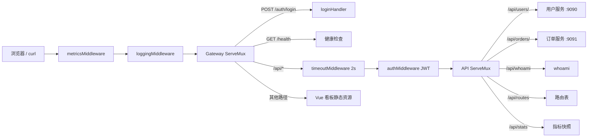

# 架构与请求流程

[返回 README](../README.md)

## 模块与端口

| 模块 | 端口 | 职责 |
|---|---|---|
| `gateway` | 8080 | 路由、认证、超时、指标、静态看板 |
| `backend-user` | 9090 | 用户服务，`GET /users/{id}` |
| `backend-order` | 9091 | 订单服务，`GET /orders/slow` |
| `backend` | 9090 | 早期练习服务，与 `backend-user` 端口冲突 |

网关的上游地址写在 `gateway/routes.go` 的 `proxyRoutes` 中，目前是硬编码的 `127.0.0.1`。

## 请求链路



实际包装顺序：

```go
handler := metricsMiddleware(loggingMiddleware(mux), gatewayMetrics)
apiHandler := timeoutMiddleware(authMiddleware(apiMux, jwtSecret), apiTimeout)
```

因此 `/api/*` 的完整顺序是：指标 → 日志 → 超时 → 认证 → 业务 Handler。登录、健康检查和看板静态资源不经过认证与超时。

## 中间件

### 日志

`gateway/middleware.go` 的 `loggingMiddleware` 记录方法、路径、来源地址和处理耗时。

### 超时

`timeoutMiddleware` 给请求 Context 加 2 秒超时。超时后：

1. `ReverseProxy` 的 `ErrorHandler` 收到 `context.DeadlineExceeded`
2. 客户端收到 `504 Gateway Timeout`
3. 上游请求的 Context 被取消，订单服务打印 `Slow order canceled`
4. 指标把这次请求记为 5xx

超时只作用于 `/api/*`，登录和健康检查不受影响。

### 认证

`authMiddleware` 读取 `Authorization: Bearer <token>`，验证通过后把 `user_id` 写入 Context，键类型是私有的 `userIDContextKey{}`。缺少或无效 Token 都返回 `401`。

## 反向代理

`newReverseProxy` 在 `Rewrite` 中做四件事：

1. `SetURL(targetURL)` 设置上游地址
2. 从路径中剥离 `/api` 前缀
3. 清空 `RawPath`，避免转义路径不一致
4. `SetXForwarded()` 写入 `X-Forwarded-*` 头

路径映射示例：

```text
/api/users/123   -> 127.0.0.1:9090/users/123
/api/orders/slow -> 127.0.0.1:9091/orders/slow
```

`ErrorHandler` 区分两类错误：

| 条件 | 返回 |
|---|---|
| `context.DeadlineExceeded` | 504 Gateway Timeout |
| 其他（连接失败、上游中断等） | 502 Bad Gateway |

## JWT 与密钥

### 登录

`POST /auth/login` 的流程：

1. 限制请求体 1 MiB，拒绝未知字段
2. 用 bcrypt 校验用户名和密码
3. 签发 HS256 Token，有效期 15 分钟

Claims 包含：

| 字段 | 值 |
|---|---|
| `iss` | `go-gateway-practice` |
| `aud` | `go-gateway` |
| `sub` | 用户 ID |
| `user_id` | 用户 ID |
| `iat` / `nbf` / `exp` | 签发、生效、过期时间 |
| `jti` | 16 字节随机数的十六进制 |

校验时要求：只接受 HS256、issuer 与 audience 正确、必须包含过期时间、`sub` 与 `user_id` 一致。

### 密钥优先级

`loadOrCreateJWTSecret` 按顺序读取：

1. 环境变量 `JWT_SECRET`（Base64，至少 32 字节）
2. 文件 `data/jwt.secret`（同上）
3. 自动生成 32 字节随机密钥，Base64 后写入 `data/jwt.secret`

写入使用 `O_CREATE|O_EXCL` 和 `0600` 权限，目录权限 `0700`；如果并发启动时文件已存在，会重新读取而不是覆盖。

## 指标

`gateway/metrics.go` 在进程内保存：

- 总请求数与 2xx / 3xx / 4xx / 5xx 计数
- 最近 200 次耗时，用于计算平均值与 P95
- 最近 50 条请求记录，供看板展示趋势与上游状态
- 按路由前缀聚合的请求数、错误数与平均耗时
- 当前正在处理的请求数

为了不让看板自己的轮询污染数据，`/health`、`/api/routes`、`/api/stats` 以及看板静态资源（`/`、`/assets/*`）不计入统计。

并发安全由 `sync.Mutex` 保证；`statusRecorder` 捕获状态码，并通过 `Unwrap` 让 `http.ResponseController` 仍能访问底层 `ResponseWriter`。

## 静态看板

`gateway/web.go` 使用：

```go
//go:embed all:web/dist
var webDist embed.FS
```

`GET /` 由 `http.FileServerFS` 托管构建产物。`web/dist` 在构建前只保留一个 `.gitkeep`，此时网关会返回一页提示，告知先执行 `npm run build`，不会影响 `go build`。

Vite 构建产物在编译期嵌入二进制，所以重新构建前端后需要重新编译或重启网关。

## 并发与生命周期

- 所有服务使用 `http.Server`，仅网关设置了 `ReadHeaderTimeout: 5s`
- 指标与请求历史在重启后清零
- 目前没有 `Server.Shutdown` 优雅退出
